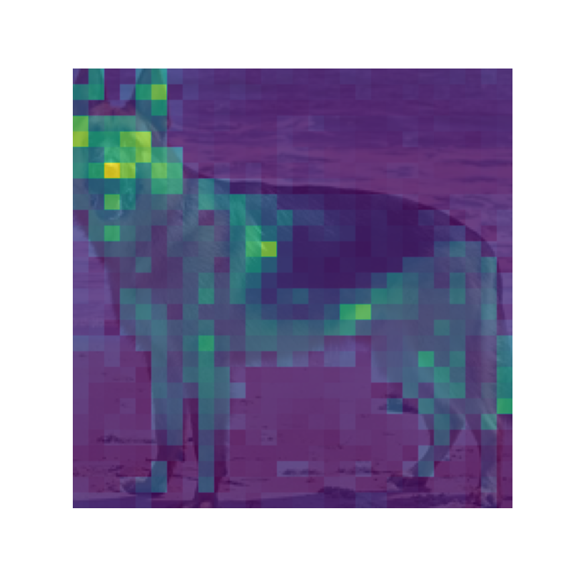

# Computer Vision Labs

**Convolutions, residual networks, transfer learning and Vision Transformer attention.**

Academic work by **Aitana Cantó Rico** for **COMPX326 - Computer Vision**, University of Waikato, New Zealand, during the 2025 international study period.



## What is implemented

| Lab | Focus | Implementation |
| --- | --- | --- |
| [01 - Convolutions](labs/01-convolutions/) | CNN foundations | NumPy convolution operators with single/multiple channels; PyTorch gradients |
| [02 - ResNets](labs/02-resnets/) | Residual architectures | BasicBlock, Bottleneck, ResNet-18 and ResNet-50; inference using official pretrained weights |
| [03 - Transfer learning](labs/03-transfer-learning/) | Image classification | EfficientNetV2 on a balanced CIFAR-10 subset, augmentation and partial fine-tuning |
| [04 - ViT attention](labs/04-vit-attention/) | Attention visualisation | DINO-pretrained ViTs, per-head attention and patch-size comparisons |

The solutions complete course-provided scaffolding. The networks and pretrained weights are credited to their original projects; this repository does not claim to have trained ResNet or DINO from scratch.

## Run a lab

Create an environment and install `requirements.txt`, then run each script **from its lab directory**. For example:

```bash
python -m venv .venv
python -m pip install -r requirements.txt
python scripts/download_resnet_weights.py
cd labs/02-resnets
python assignment2.py
```

Activate `.venv` before installation and execution; see [setup](docs/SETUP.md) for Windows and Unix commands. Training and model downloads can take time.

## Explore

- [Setup and individual commands](docs/SETUP.md)
- [Experiment scope and compatibility notes](docs/EXPERIMENTS.md)
- [Academic context and sources](docs/ACADEMIC_CONTEXT.md)

